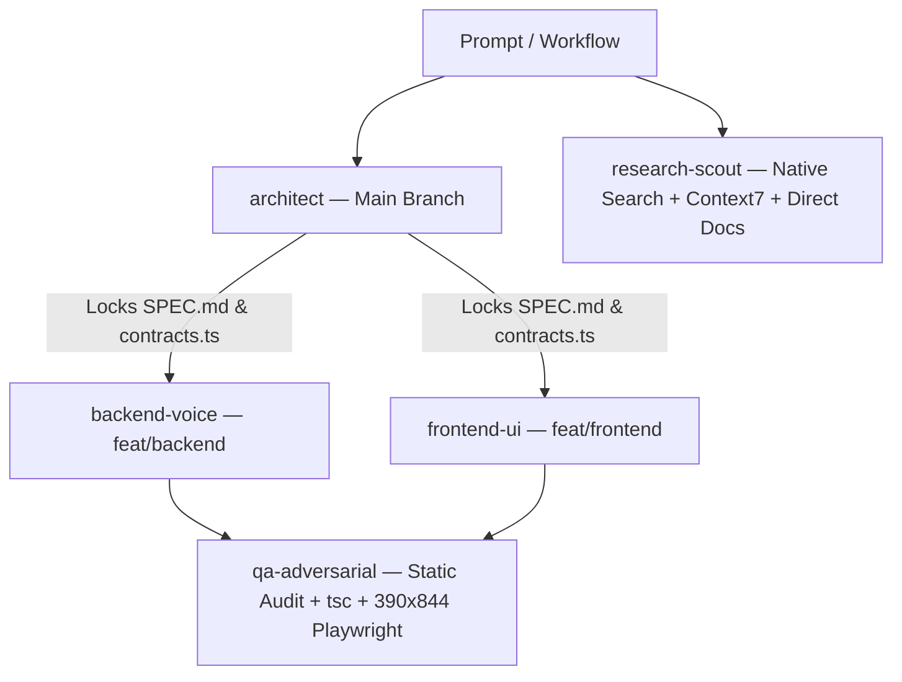

# hyperxagent

[](./LICENSE)
[](https://bun.sh)
[](./mcp/mcp_config.template.json)
[](./AGENTS.md)

Production-grade multi-agent engineering harness engineered for **$0-tier infrastructure**, **cross-provider compatibility** (Antigravity, Claude Code, Cursor, Codex), and **3x parallel build throughput** across isolated Git worktrees.

## Architecture



## Cross-Provider Compatibility

`hyperxagent` ships universal entrypoints so any coding agent can adopt the same rules and skills:
- `AGENTS.md` — Antigravity, Codex, OpenCode, and multi-agent runners
- `CLAUDE.md` — Claude Code
- `.cursorrules` — Cursor
- `.agents/skills/*/SKILL.md` — Progressive skill packages

## Quickstart

### 1. Validate Harness & Security Gates
```bash
bun run validate
bun run audit
```

### 2. Install into a Target Project
Links `.agents/`, `AGENTS.md`, `CLAUDE.md`, `.cursorrules`, generates `.antigravity/mcp_config.json`, and installs `src/lib/geminiPool.ts`:
```bash
bun run install:target /path/to/target-repo
```

### 3. Spin Up 3 Parallel Worktrees (Zero File Collisions)
```bash
cd /path/to/target-repo
bash /path/to/hyperxagent/scripts/setup-worktrees.sh
```

## 3-Account Execution Matrix

| Window | Account | Directory | Branch | Active Subagents | Owned Paths |
| --- | --- | --- | --- | --- | --- |
| **Window 1** | Account 1 (Lead) | `./` (repo root) | `main` | `architect`, `qa-adversarial` | `plans/*`, `src/types/*` |
| **Window 2** | Account 2 (API) | `../wt-account2-backend` | `feat/backend` | `backend-voice` | `src/app/api/*`, `src/lib/*` |
| **Window 3** | Account 3 (UI) | `../wt-account3-ui` | `feat/frontend` | `frontend-ui` | `src/app/page.tsx`, `src/components/*` |

## Workflows

* `/build-mvp` — Executes Phase 1 (`architect` contract lock), Phase 2 (parallel worktree swarm), and Phase 3 (`qa-adversarial` merge + static/security + `390x844` audit).
* `/deep-research` — Launches `research-scout` using native search / MCPs, `context7`, and direct doc inspection at zero API cost.
